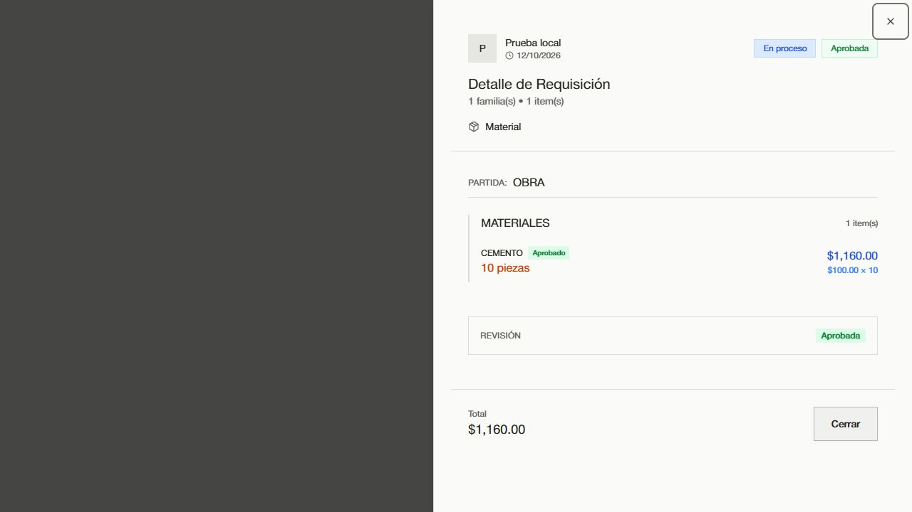

# Requisiciones: correcciones y análisis posterior

Se corrigieron los cuatro defectos del [diagnóstico original](./REPORTE.md). Las correcciones están en el árbol de trabajo local sobre `main`; esta revisión no publica otro commit ni despliega Convex.

## Correcciones realizadas

| Defecto | Comportamiento corregido |
| --- | --- |
| El formulario enviaba una partida de nivel 2 o 3 y el servidor exigía nivel 1 | Tanto creación como edición envían la partida raíz seleccionada. Los IDs de familia y subpartida siguen sirviendo para precargar el presupuesto. Se mantienen las descripciones de `OTRO`. |
| Una edición de materiales conservaba la aprobación anterior | Cambiar los materiales o el tipo reinicia la revisión de la cabecera y los materiales, y elimina los datos de aprobación anteriores. El pago queda bloqueado hasta completar otra revisión. Guardar materiales idénticos, cambiar sólo una nota o reordenar filas conserva IDs, aprobaciones y notas de revisión. |
| El servidor aceptaba requisiciones vacías y cantidades inválidas | Creación y edición rechazan listas vacías, cantidades no positivas o no finitas, descripciones/unidades/familias vacías e importes negativos o no finitos antes de escribir. Se permiten cantidades fraccionarias e importes opcionales o cero. |
| El detalle multiplicaba dos veces por la cantidad | El total de línea aplica IVA al importe total almacenado; el precio unitario se obtiene dividiendo entre la cantidad. Diez piezas de $100 muestran $1,160, igual que el total inferior. |

La invalidación de revisión conserva las dimensiones independientes de pago y entrega. No se migraron ni repararon registros históricos del despliegue publicado.

## Validación

| Comprobación | Resultado |
| --- | --- |
| Nueva integración de requisiciones, funciones y esquema reales en memoria | 40 pruebas correctas |
| Estados, permisos y transiciones de requisiciones | 34 pruebas correctas |
| Referencias y eliminación de partidas | 75 pruebas correctas |
| Total de las tres suites anteriores | **149 correctas, 0 fallidas** |
| Reglas de notificaciones | Correctas |
| Interfaz en 320, 390, 768, 1024, 1440 y 1536 px | Correcta, seis roles y 102 capturas |
| Formulario real con adaptador local | Cantidad cero deshabilita el envío; cantidad válida envía `partida_id: "root"`, `monto: 1000` |
| Detalle real con adaptador local | Línea $1,160; precio unitario $100 × 10; total $1,160 |
| Compilación `npm run build` | Correcta; permanece el aviso de Vite sobre tamaño de chunks |
| Tipos de Convex | Correctos |
| ESLint de modal y nuevos helpers | Correcto |
| `git diff --check` | Correcto |

Las pruebas con `convex-test` usan las funciones, validadores, índices y transacciones reales, con identidades y datos sintéticos. El transporte externo y los temporizadores de correo se bloquean. La comprobación visual usa el componente real con respuestas simuladas: no acredita un recorrido autenticado en el despliegue publicado ni la entrega de correos. No se modificaron requisiciones reales.

Una repetición dentro del sandbox de Windows falló al cargar archivos temporales de Vitest (`ENOENT`), antes de ejecutar algunas suites. La repetición fuera del sandbox terminó con las 149 pruebas correctas; el JSON enlazado contiene esa ejecución final.

## Casos adicionales reproducidos y pendientes

Estos tres diagnósticos se ejecutan por separado de las pruebas de regresión. Fallan porque describen el comportamiento deseado que todavía falta; no son correcciones incluidas en esta entrega.

### Alta: una edición antigua sobrescribe materiales recientes

Dos usuarios abren una requisición con 10 unidades. El primero guarda 20 unidades. El segundo cambia una nota y envía su formulario anterior, que todavía contiene 10 unidades. `requisiciones.update` acepta la segunda escritura y la cantidad vuelve a 10. Las transacciones evitan escrituras simultáneas inconsistentes, pero la API de edición no exige una versión esperada del registro.

La prueba posterior espera conservar las 20 unidades y obtiene 10. Conviene incorporar una versión de edición y rechazar los formularios obsoletos antes de reemplazar materiales; la interfaz debe conservar el borrador y ofrecer recargar.

### Alta: pago en obra pendiente con importe anterior

Crear y aprobar materiales por $1,000, solicitar un pago en obra de $1,000, editar materiales a $2,000 y volver a aprobar. La revisión se reinicia correctamente, pero `pago_obra` conserva `estado: "pendiente"` e `importe: 1000`. El importe y la solicitud no quedan vinculados a la versión revisada de los materiales.

La prueba confirma materiales de $2,000 y solicitud anterior de $1,000; falla al exigir que ya no siga pendiente. Conviene invalidar o exigir reconfirmar la solicitud pendiente cuando cambia el alcance. La política para anticipos o pagos parciales debe conservarse explícitamente al implementar esa solución.

### Media: repetir una aprobación completa duplica el historial

Invocar dos veces `reviewRequisicion` con las mismas decisiones agrega dos entradas `reviewed`; contando la creación, el historial pasa de dos a tres filas. La revisión individual ya tiene protección frente a repeticiones, pero la revisión completa no evita este duplicado.

La prueba espera conservar dos filas y obtiene tres. Conviene usar una clave de idempotencia por envío para distinguir el reintento de una nueva revisión, incluidos comentarios y documentos. El caso reproducido demuestra duplicación del historial; no demuestra correos duplicados, y la selección actual de avisos evita repetirlos cuando el estado global no cambia.

## Evidencia y reproducción

- [Pruebas de integración corregidas](../../convex/requisicionIntegration.test.mjs).
- [Resultados finales: 149 pruebas](./post-fix-results.json).
- [Diagnósticos de los tres casos pendientes](./edge-cases.test.mjs).
- [Resultados de los diagnósticos: tres fallos esperados](./edge-case-results.json).
- [Payload observado del formulario corregido](./form-payload-corregido.json).
- [Detalle corregido](./detalle-total-corregido.jpg).
- Capturas de interfaz: `test-results/requisiciones-responsive/`.

Desde la raíz del proyecto:

```powershell
npx vitest run --config vitest.config.ts --configLoader runner convex/requisicionIntegration.test.mjs convex/requisicionStates.test.mjs convex/partidaDeletion.test.mjs
npm run test:requisicion-notifications
npm run test:requisiciones-ui
npm run build
npm run typecheck:convex
npx eslint src/components/modals/RequisicionModal.tsx src/lib/requisicion-draft.ts convex/requisicionInputRules.ts
```

Para reproducir los tres casos todavía abiertos (salida esperada: 1):

```powershell
npx vitest run --config output/requisiciones-validation-2026-10-12/edge-cases.config.mjs --configLoader runner
```

La suite forense original y su JSON se conservan como evidencia del estado anterior. Para validar las correcciones se utiliza la nueva suite de integración; las expectativas de la suite original no se actualizaron.


