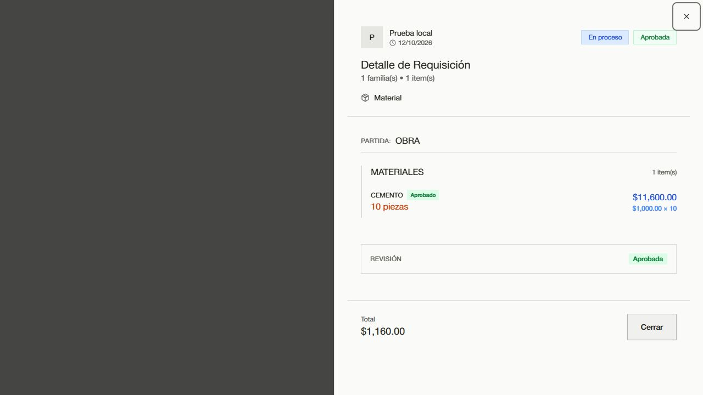

# Pruebas de requisiciones — 12 de octubre de 2026

> Informe histórico del diagnóstico inicial. Las cuatro correcciones y el análisis posterior están en [CORRECCIONES_Y_EDGE_CASES.md](./CORRECCIONES_Y_EDGE_CASES.md).

**Resultado: el módulo necesita correcciones antes de considerarlo validado.** Se reprodujeron cuatro problemas en el código actual de `main`, commit `cc694a8eb3441c6a7bc32a047473d0030e790e07`.

## Alcance y resultados

| Comprobación | Resultado |
| --- | --- |
| Reglas de notificaciones (`npm run test:requisicion-notifications`) | Correctas |
| Estados, permisos, concurrencia e historial (`convex/requisicionStates.test.mjs`) | 34 pruebas correctas |
| Interfaz existente (`npm run test:requisiciones-ui`) | Correcta; seis resoluciones, seis roles incluyendo administrador, 102 capturas |
| Integración adicional con esquema y transacciones reales de Convex en memoria | 18 pruebas: 12 correctas y 6 fallidas |
| Formulario y detalle reales montados con datos locales de prueba | Confirmados el payload incompatible y el importe incorrecto |
| Convex configurado (`animated-walrus-612`), consulta `users:getCurrentUser` sin sesión | La consulta responde correctamente; no hay sesión de usuario para validar un recorrido autenticado publicado |
| Configuración de correo en Convex | Existen `RESEND_API_KEY`, `RESEND_FROM_EMAIL` y `APP_URL`; no se expusieron sus valores ni se enviaron correos |

Se probaron anchos de 320, 390, 768, 1024, 1440 y 1536 px. La prueba de interfaz cubre filtros, pestañas, navegación por teclado, contexto, aprobación individual y cantidades parciales, proveedores, estados independientes de pago y entrega, reversión, prevención de doble envío, conservación del borrador tras error, pago en obra, remisiones y visibilidad según rol.

Las pruebas de integración adicionales invocan las funciones reales mediante `convex-test`, con validadores, esquema, índices y transacciones. Cubren creación según rol, aislamiento entre organizaciones, lectura de contratistas, revisión, historial, notificaciones en aplicación, solicitud de pago, recepción antes del pago e idempotencia. Los temporizadores y el transporte de red se bloquean en estas pruebas. No se crearon, editaron, pagaron ni eliminaron requisiciones del despliegue publicado. La presencia de configuración de correo no demuestra entrega efectiva por Resend.

## Problemas reproducidos

### 1. Alta: creación desde el presupuesto incompatible con el servidor

En el formulario real: seleccionar partida `OBRA`, familia `MATERIALES`, con una subpartida `CEMENTO`, 10 piezas a $100. El formulario precarga correctamente el importe, pero al enviar construye `items[0].partida_id = "leaf"`, referencia de nivel 3. La validación del servidor exige una referencia de nivel 1. Una llamada con este mismo tipo de referencia, usando IDs válidos del esquema real, falla con «El concepto presupuestario ya no existe o no pertenece al proyecto y nivel seleccionados».

También la familia sin subpartidas puede producir una referencia de nivel 2 por la prioridad `sp.partida_id || item.partida_id || selectedPartida.id`. La creación con una referencia de nivel 1 sí pasa.

Evidencia: `src/components/modals/RequisicionModal.tsx`, funciones `createSubPartidaFromBudget`, `handleFamiliaChange` y `handleSubmit`; `convex/partidaReferences.ts`, función `assertRequisicionBudgetItems`; prueba `accepts the level-3 budget reference submitted by the current creation form`.

La respuesta de éxito del formulario durante la inspección pertenece exclusivamente al adaptador local. El rechazo se confirma por separado en la función real de Convex en memoria.

### 2. Alta: modificación de materiales conserva una aprobación que ya no corresponde

Crear una requisición de 10 unidades y aprobarla completamente. Editarla a 20 unidades mediante `requisiciones.update`. Los items se reemplazan y quedan `pendiente`, pero la cabecera conserva `status_revision = "Aprobada"`. La revisión sólo se reinicia para estados anteriores `Rechazada` o `Parcialmente Aprobada`.

La prueba adicional invoca después `requisiciones.updateStatus` como finanzas y consigue `Pagado` con `{ success: true, changed: true }`, aunque los materiales nuevos no se revisaron. Son dos pruebas fallidas para el mismo defecto: invalidación de aprobación y bloqueo de pago.

Evidencia: `convex/requisiciones.ts`, función `update`, condición `wasReviewed` y reinserción de items; función `updateStatus`.

### 3. Media: validación insuficiente de cantidades en el servidor

La función real `requisiciones.create` acepta `items: []`, `cantidad: 0` y `cantidad: -2`. Se confirman tres pruebas fallidas. La interfaz aplica controles de cantidad, pero el servidor no garantiza esa regla al recibir la solicitud. Una requisición sin items queda pendiente y no puede pasar la revisión completa, que sí exige materiales.

Evidencia: `convex/requisiciones.ts`, función `create`; `convex/partidaReferences.ts`, función `assertRequisicionBudgetItems`.

### 4. Media: importe por material multiplicado dos veces en el detalle

Con 10 unidades a $100, el importe guardado es $1,000 y el total con IVA es $1,160. El detalle real muestra **$11,600** en la línea del material, y **$1,160** en el total inferior. La línea usa `sp.monto * sp.cantidad * 1.16`, aunque `monto` ya representa `cantidad × precio_unitario`.



Evidencia: `src/components/modals/RequisicionModal.tsx`, presentación del importe por subpartida en modo de vista; `src/hooks/nueva-requisicion-modal.ts`, definición de `monto` como total.

## Evidencia y reproducción

- [Pruebas adicionales](./requisiciones.integration.test.mjs)
- [Configuración de las pruebas](./vitest.config.mjs)
- [Resultados JSON](./integration-results.json)
- [Payload observado del formulario](./form-payload.json)
- [Captura del detalle](./detalle-total-incorrecto.jpg)
- Las 102 capturas de la prueba existente están en `test-results/requisiciones-responsive/`.

Desde la raíz del proyecto:

```powershell
npm run test:requisicion-notifications
npm run test:requisicion-states
npm run test:requisiciones-ui
npx vitest run --config output/requisiciones-validation-2026-10-12/vitest.config.mjs --configLoader runner
```

El último comando conserva las seis regresiones fallidas para reproducir los defectos; su código de salida es 1. La inspección del formulario se puede repetir con `node node_modules/vite/bin/vite.js --config output/requisiciones-validation-2026-10-12/form-vite.config.mjs` y `http://127.0.0.1:4198/output/requisiciones-validation-2026-10-12/form-preview.html`; añadir `?mode=view` muestra el detalle con la discrepancia de importe.

No se modificó el código de funcionamiento del módulo ni se publicó un despliegue durante esta validación. Se añadieron únicamente el reporte y los recursos de prueba locales.
