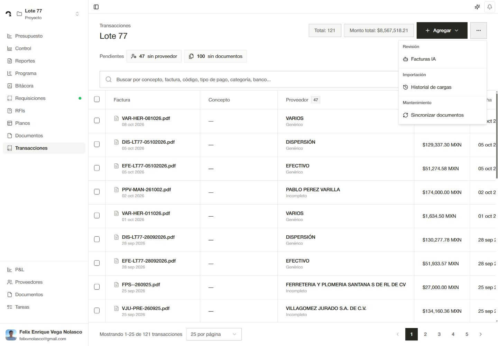
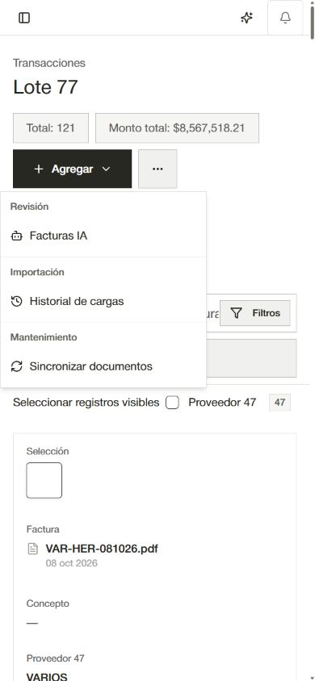

# P06 · Obra · Cabecera de Transacciones

Implementación del 18 de noviembre de 2026, limitada a `/proyecto/:proyectoId/transacciones`.

## Resultado

- «Agregar» permanece visible como acción principal, con Agregar pago, Subir Excel y Cargar factura. Usa la variante local `inverse`; el uso global del componente conserva su presentación predeterminada.
- «Herramientas de transacciones» reúne Revisión → Facturas IA, Importación → Historial de cargas y Mantenimiento → Sincronizar documentos, con grupos y separadores Radix.
- Total, Monto total y los indicadores interactivos sin proveedor/sin documentos permanecen visibles. Tabla, filtros, columnas, selección, paginación y cálculos conservan su lógica.
- Los diálogos originales se montan fuera del menú. Las consultas de historial y Facturas IA siguen diferidas. Escape devuelve el foco al disparador correspondiente; cambiar de proyecto restablece el contexto de menús y diálogos.
- Sincronizar sólo ejecuta su función al seleccionar explícitamente la opción. Conserva spinner, estado deshabilitado, resultados y toasts; añade comprobación de escritura y evita una segunda ejecución mientras está ocupado.

## Archivos de aplicación

1. `src/pages/ProyectoTransaccionesTable/ProyectoTransaccionesTablePage.tsx`: composición de la cabecera y contexto/foco de las acciones de creación.
2. `src/components/transactions/ProjectTransactionTools.tsx` (nuevo): menú secundario y apertura de los diálogos originales.
3. `src/components/transactions/AddTransactionMenu.tsx`: presentación principal opcional, referencia de foco y cancelación de callbacks al desmontar.
4. `src/components/invoices/InvoiceBackfillDialog.tsx`: apertura controlada y trigger ocultable, con valores predeterminados compatibles.
5. `src/components/transactions/LaborImportHistory.tsx`: apertura controlada, trigger ocultable y reinicio de paginación/expansión.

No se modificaron la ruta protegida, el backend, los componentes UI compartidos, el CSS global ni la página global de transacciones. Los demás cambios del árbol pertenecen a trabajos concurrentes.

## Comprobaciones

| Comprobación | Resultado |
| --- | --- |
| `npm run build` | Aprobada; advertencia de tamaño de bundles de Vite |
| ESLint de los cinco archivos | Aprobado; aviso de configuración Tailwind de shadcn |
| `npm run test:invoices` | Aprobada |
| `npm run test:labor-import` | Aprobada |
| `npm run test:labor-import-convex` | 34/35 aprobadas; fallo ajeno a P06 descrito abajo |
| UI real, Lote 77, administrador | Agregar y sus tres accesos; historial y Facturas IA; apertura/cierre/reapertura; Escape, flechas, Enter y retorno de foco |
| Tamaños CSS reales | 1440 × 1000, 1024 × 1000 y 390 × 844; ancho del documento igual al viewport y controles principales de 48 px |
| Indicadores pendientes | Activan/desactivan filtros y parámetros `proveedor=unassigned` / `documentos=sin`; se restableció la URL original |
| Verificación aislada con la página real | Roles admin/user/viewer/finance, consultas diferidas, reinicio del historial, cambio de obra, selección IA y sincronización ficticia |

El fallo Convex ocurre en `convex/laborPaymentImports.test.mjs:276`, caso «retains manual honorarios and calculates indirectos only after their starting date»: esperaba gasto total `6225` y obtuvo `6405`. Ni el test ni su implementación backend fueron modificados por P06.

## Permisos y límites de la validación

La ruta de producción sigue exigiendo `requiredRole="user"`, con el control de acceso al proyecto existente. El componente de revisión mantiene su filtro interno admin/finance y también se filtra el item. El menú no muestra sincronización ni creación a viewer; mantiene la consulta del historial separada de los permisos de escritura. Las comprobaciones de finance y viewer se hicieron en un entorno aislado, sin modificar ni eludir la protección de producción.

No se guardaron pagos, subieron archivos, iniciaron/aceptaron análisis IA ni sincronizaron documentos reales. El estado de sincronización se comprobó con una promesa ficticia: cero escrituras al montar/abrir el menú y una sola llamada simulada al seleccionar la opción. El registro está en [registro-admin.json](registro-admin.json).

La verificación aislada importa la página y los componentes reales con un adaptador Convex sin backend. Su código está en `verificacion/`; la versión estática en `verificacion/compiled/` puede servirse desde el Vite existente bajo `/outputs/P06-implementacion-2026-11-18/verificacion/compiled/index.html?role=admin#/proyecto/project-a/transacciones`.

## Capturas nuevas

| Superficie | Escritorio | Móvil |
| --- | --- | --- |
| Cabecera cerrada | [1440](cabecera-1440.jpg) · [1024](cabecera-1024.jpg) | [390](cabecera-390.jpg) |
| Menú Agregar | [1440](agregar-1440.jpg) | [390](agregar-390.jpg) |
| Herramientas | [1440](herramientas-1440.jpg) · [1024](herramientas-1024.jpg) | [390](herramientas-390.jpg) |

Diálogos originales: [Pago](pago-390.jpg), [Excel](excel-390.jpg), [Factura](factura-390.jpg), [Historial](historial-390.jpg), [Facturas IA](facturas-ia-390.jpg).

Evidencia aislada: [Viewer](permisos-viewer-fixture.jpg), [Usuario](permisos-user-fixture.jpg), [Sincronización ficticia](sincronizando-fixture.jpg). Medidas: [medidas.json](medidas.json). Logs: [build](build.log), [ESLint](eslint.log).

