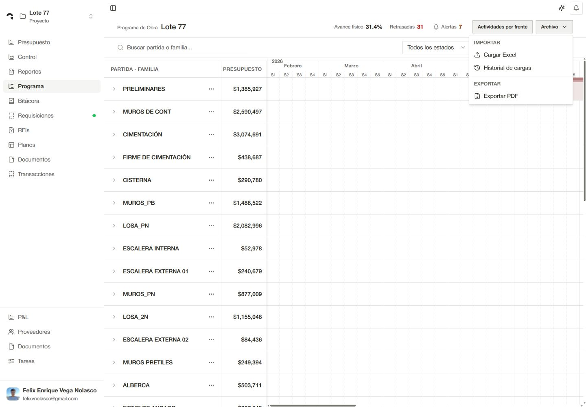
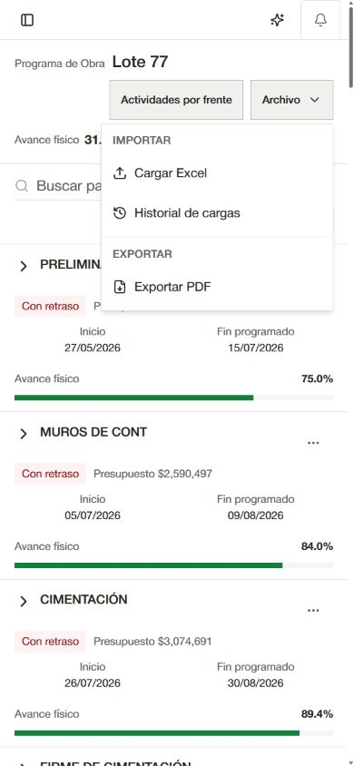

# P08 · Obra › Programa · Archivo

Implementación completada el 18 de noviembre de 2026 sobre el árbol local compartido. Se aplicó únicamente la propuesta «Archivo reúne importación, historial y exportación».

## Resultado

La cabecera muestra un único menú **Archivo** con ChevronDown. El grupo **Importar** contiene **Cargar Excel** y **Historial de cargas**; después de un separador, **Exportar** contiene **Exportar PDF**. Se retiró el botón independiente del historial.

El menú permanece disponible con el programa vacío y durante lectura, carga o exportación. El historial se puede consultar en esos estados; carga y exportación se bloquean por opción según disponibilidad. Exportar PDF queda deshabilitado sin filas. Se conserva la entrada Cargar Excel del estado vacío y la condición exacta de capacidad `write && (!config || plan)`.

Los controles de cabecera miden 32 px en escritorio y 44 px por debajo de 850 px. Las opciones del menú tienen una altura mínima de 44 px en móvil y 32 px en escritorio. El ancho del menú se limita al viewport.

Los diálogos se abren después de cerrar el menú y devuelven el foco a Archivo al salir por Escape, Cancelar o cierre. El selector nativo sigue abriendo directamente desde el gesto de seleccionar Cargar Excel. El menú y el historial se cierran al cambiar de proyecto.

Se conservaron búsqueda, filtro de estado, Hoy, Vista, Leyenda, Avance físico, Retrasadas, Alertas, Actividades por frente y Salir de enfoque, además de las acciones por fila. No se modificaron el cronograma, cálculos, PDF, hook de importación, backend ni protección de ruta.

## Archivos

| Archivo | Cambio |
| --- | --- |
| `src/pages/Programa Obra/ProgramaObra.tsx` | Agrupación, disponibilidad, tamaños, progreso y coordinación de foco. |
| `src/pages/Programa Obra/ProgramaObraExportDialog.tsx` | Prop opcional para devolver el foco al origen. |
| `src/pages/Programa Obra/ProgramaObraImportHistory.tsx` | Misma prop opcional; consultas y contenido existentes conservados. |
| `scripts/test-programa-import-history-ui.mjs` | Acceso al historial actualizado a Archivo. |
| `scripts/test-programa-toolbar-ui.mjs` | Prueba integrada de P08 y comparación opcional del enfoque contra HEAD. |
| `e2e/programa/toolbar-{preview.html,preview.tsx,convex-stub.ts,import-hook.ts}` | Fixtures locales para vacíos, capacidades, operaciones ocupadas y cambio de proyecto. |

## Validación

Todas las comprobaciones finales pasaron:

- `npm run build`: TypeScript y compilación Vite/PWA correctos. Persiste la advertencia de chunks mayores de 500 kB.
- `node scripts/test-programa-toolbar-ui.mjs`: 1440 × 1000, 1024 × 1000 y 390 × 844; grupos, orden, límites del menú, tamaños, flechas/Enter/Escape, retorno de foco, reapertura de historial/PDF, selector sin archivo, consultas diferidas, programa vacío, capacidades `write/plan/config`, lector, lectura/carga/exportación ocupadas, cambio de proyecto y enfoque. Cero escrituras y cero errores de página. Ver `ui-results.json`.
- `npm run test:programa-export-ui`: exportación real de datos ficticios; selección completa/parcial/resumida, avisos, filtros, cancelación, fallo, restauración de scroll, móvil y lector. Ver `export-ui-captures.json`.
- `npm run test:programa-import-ui`: componentes reales y transporte simulado; Excel sintéticos XLS/XLSX, revisión, bytes originales, historial, paginación, permisos, recuperación y fallos a 1440/390/320 px. Ver `import-ui-results.json` y `regresion-import/`.
- `npm run test:programa-import`: 26 pruebas correctas. Ver `import-rules.log`.
- `git diff --check` de los archivos modificados: sin errores de whitespace.
- Sesión autenticada de Lote 77: inspección real a 1440 y 390 px; Archivo, historial y diálogo PDF; apertura, cancelación/Escape y foco de vuelta a Archivo. Sin desbordamiento horizontal observado. No se seleccionaron Excel, confirmaron importaciones, generaron PDF ni ejecutaron escrituras sobre datos reales.

Las capturas de regresión generadas sobre artefactos versionados se copiaron aquí y se repusieron los PNG anteriores que estaban limpios al empezar. Los cambios de otros chats permanecen separados; no se hizo stage ni commit.

## Evidencia visual

Las imágenes `app-*` corresponden a la aplicación autenticada modificada; `fixture-*` usa el componente real con datos ficticios. No son las simulaciones de la auditoría.

| Vista | Escritorio | Móvil |
| --- | --- | --- |
| Cabecera cerrada | [1440](app-cerrado-1440.jpg) | [390](app-cerrado-390.jpg) |
| Archivo abierto | [1440](app-archivo-1440.jpg) | [390](app-archivo-390.jpg) |
| Historial real | [1440](app-historial-1440.jpg) | [Fixture 390](fixture-historial-390.png) |
| Diálogo PDF | [1440](app-pdf-1440.jpg) | [390](app-pdf-390.jpg) |
| Programa vacío | [1440](fixture-vacio-1440.png) | [390](fixture-vacio-390.png) |
| Carga ocupada | [1440](fixture-uploading-1440.png) | [390](fixture-uploading-390.png) |
| Intermedio | [Archivo 1024](fixture-archivo-1024.png) | — |

## Observación previa y límites

En el fixture con SidebarProvider y StrictMode, el sidebar permanece abierto durante el enfoque. La misma secuencia se reprodujo con `ProgramaObra.tsx` leído de `git HEAD` antes de P08: abierto → abierto → abierto. Se conservó ese comportamiento y el estado al salir; no se corrigió la lógica del sidebar por estar fuera de alcance. Evidencia: `baseline-focus.json`, reproducible mediante `node scripts/test-programa-toolbar-ui.mjs --baseline-focus`.

Los estados de capacidades, programa vacío, carga ocupada y cambio de proyecto se ejercitaron mediante fixtures, sin cambiar permisos ni datos reales. En Lote 77 el historial está vacío; la regresión aislada cubre historial con registros y paginación.
